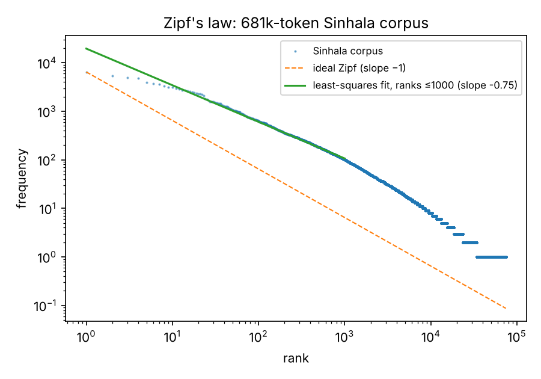

# 2026 reproduction

Generated by `reproduce/reproduce_2026.py` from the derived data in `data/derived/`. Library versions differ from 2010 (scikit-learn instead of SVMlight; random splits differ), so small differences from the original report are expected.

## 1. Character MLE (white space excluded)

Total basic characters: 2,268,895

| Rank | Char | Code point | Count | MLE |
|---|---|---|---|---|
| 1 | න | U+0DB1 | 224,464 | 0.0989 |
| 2 | ව | U+0DC0 | 197,772 | 0.0872 |
| 3 | ය | U+0DBA | 180,277 | 0.0795 |
| 4 | ක | U+0D9A | 171,259 | 0.0755 |
| 5 | ර | U+0DBB | 165,380 | 0.0729 |
| 6 | ම | U+0DB8 | 160,238 | 0.0706 |
| 7 | ත | U+0DAD | 158,262 | 0.0698 |
| 8 | ස | U+0DC3 | 127,016 | 0.0560 |
| 9 | ද | U+0DAF | 100,910 | 0.0445 |
| 10 | ප | U+0DB4 | 99,719 | 0.0440 |

No independent vowel appears in the top ten; the first is at rank 16. Vowel sounds are mostly written as dependent signs attached to consonants, which this count (basic characters only) excludes.

## 2. Zipf's law

Tokens: 681,233 · Types: 74,369 · Hapax legomena: 40,166 (54% of types)

| Fit range | Slope | R² |
|---|---|---|
| Ranks 1–1000 | -0.754 | 0.993 |
| All ranks | -1.139 | 0.966 |

The 2010 report judged Zipf behaviour visually from the log-log plot. Fitting the exponent sharpens that conclusion: the distribution is close to linear in log-log space (high R²), so Sinhala is Zipfian in form, but the head is shallower than the classic −1 (slope -0.75). A shallower head is commonly reported for morphologically rich languages: one lemma is spread across many inflected surface forms, so the most frequent word types are individually less dominant than in English. Across all ranks the slope is -1.14, pulled down by the long tail of hapax legomena (54% of types occur once).

## 3. SVM topic classification

### News vs sports headlines (n = 1001, vocabulary = 4,131)

| Model | 2010 mean (%) | 2026 mean (%) | 2026 st. dev |
|---|---|---|---|
| Linear SVM | 90.1 | 91.9 | 2.55 |
| Polynomial SVM (d=1) | 89.9 | 91.9 | 2.59 |
| Majority-class baseline | — | 46.4 | 2.31 |

Linear vs polynomial, two-tailed paired t-test: t = 0.000, p = 1.000.

### 2009 vs 2010 news headlines (n = 1000, vocabulary = 4,552)

| Model | 2010 mean (%) | 2026 mean (%) | 2026 st. dev |
|---|---|---|---|
| Linear SVM | 90.5 | 91.7 | 1.42 |
| Polynomial SVM (d=1) | 89.7 | 91.6 | 1.58 |
| Majority-class baseline | — | 46.8 | 1.93 |

Linear vs polynomial, two-tailed paired t-test: t = 1.000, p = 0.343.

The majority-class baseline, absent from the 2010 report, shows the classifiers are doing real work: both tasks are balanced, so chance is about 50 %.
